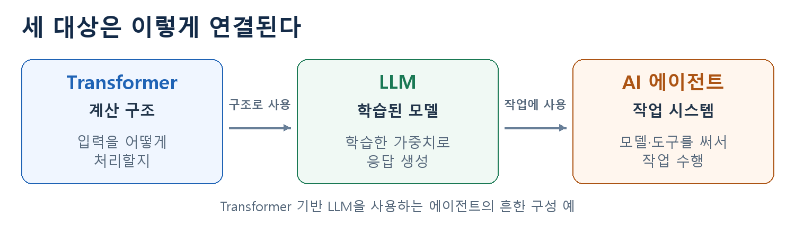

# Transformer · LLM · AI 에이전트 층위 정리

## 핵심 요약

**Transformer는 계산 구조, LLM은 언어를 학습한 모델, AI 에이전트는 모델을 이용해 작업을 수행하는 시스템이다.**
자동차로 비유하면 **설계도 → 제작·조정한 차 → 차를 활용하는 택배 시스템**에 해당한다.

아래는 흔한 **‘Transformer 기반 GPT류 LLM을 사용하는 에이전트’**를 기준으로 비교한다. LLM 열은 tokenizer·추론 엔진을 포함한 사용 관점이다.

## 세 가지의 차이

| 비교할 것 | Transformer — 계산 구조 | LLM — 학습된 모델 | AI 에이전트 — 작업 시스템 |
|---|---|---|---|
| **무엇인가?** | 정보를 어떤 계산으로 처리할지 정한 신경망 구조 | 많은 언어 데이터로 가중치를 학습한 모델 | 모델·도구·작업 상태·실행 규칙을 연결한 시스템 |
| **입력 → 출력** | 블록 실행 기준: 숫자 벡터 → 문맥을 반영한 새 벡터 | 사용 시: 문장·메시지 → 응답. 내부에서는 토큰 ID를 받아 토큰 점수 계산 | 목표·자료·도구 결과 → 도구 사용·최종 답변·작업 결과 |
| **어떤 토큰을 쓰나?** | 고정된 종류가 없음. 텍스트 조각·이미지 패치·수치 특징 등을 벡터로 표현 | 해당 모델의 tokenizer가 나눈 텍스트 조각과 특수 토큰 | LLM 부분은 그 모델의 토큰 사용. 도구에는 JSON·파일·숫자 등이 오감 |
| **내가 쓰려면?** | 이 구조로 구현된 모델을 사용하거나, 입력·출력을 정해 모델을 만듦 | 기존 모델/API를 호출. 로컬 실행은 맞는 tokenizer도 준비 | 기존 LLM에 도구·상태 저장·권한·종료 조건을 연결 |
| **파인튜닝은?** | 구조 자체가 아니라 **그 구조로 만든 학습된 모델**을 추가 학습 | 기존 LLM 가중치 전체·일부 또는 LoRA 등의 추가 파라미터 학습 | 필요하면 **내부 LLM을 학습**. 도구 코드·권한·연결 설정은 별도로 수정 |
| **기억·상태는?** | 실행 중 중간 벡터가 생김. 대화 저장 방식은 구조 밖에서 정함 | 학습 정보는 가중치, 현재 정보는 입력 문맥. 서빙은 KV cache 관리 | 대화·목표·진행 상황·도구 결과를 저장해 다음 판단에 활용 |
| **실제로 행동하나?** | 계산 구조만으로 파일·서비스를 조작하지 않음 | 응답·도구 호출 내용을 생성. 실행은 연결된 런타임이 담당 | 런타임이 권한을 확인하고 도구 실행. 읽기 전용 작업도 가능 |
| **무엇을 반복하나?** | 한 번의 모델 계산에서 레이어를 거침 | 다음 토큰 생성 반복 | 판단 → 도구 실행 → 결과 확인 반복 |
| **비용은 어디서 생기나?** | 구조·입력 크기에 따른 연산·메모리 요구 | 호출별 모델 실행·입출력 토큰·캐시 | 여러 모델 호출 + 도구 사용 + 재시도·운영 비용 |
| **문제가 나면 무엇을 보나?** | 입력 벡터·마스크·계산 구현 | 실제 입력·출력·tokenizer·생성 설정 | 도구 인자·결과·작업 상태·종료 조건 |

## 1. 입출력과 토큰은 어떻게 다른가

**Transformer는 숫자로 표현된 정보를 계산하는 구조다.** 문장을 처리한다면 텍스트를 숫자 벡터로 바꿔 넣고, 이미지라면 이미지 조각을 벡터로 바꿔 넣을 수 있다. 블록의 출력도 새 벡터다. 그 뒤에 어떤 출력 부분을 붙이는지에 따라 단어 후보의 점수, 분류 결과 등으로 이어진다. 따라서 Transformer 자체에 하나의 고정된 ‘입력 토큰 종류’나 ‘최종 답변 형식’이 있는 것은 아니다.

**LLM은 텍스트를 처리하고 생성하도록 학습된 모델이다.** 사람이 문장을 넣으면 tokenizer가 이를 토큰으로 나누고 각 토큰을 번호로 바꾼다. 대화형 모델에서는 사용자·모델 같은 발화자 정보도 모델에 맞는 메시지 형식으로 포함된다. 모델은 그 번호에 대응하는 벡터로 계산한 뒤 다음 토큰 후보들의 점수를 만든다. 생성 엔진이 토큰을 선택하고 이 과정을 반복하면 사람이 읽는 응답이 된다.

즉, **문장 → 토큰 ID → 벡터 계산 → 토큰 점수·선택 → 문장**의 흐름이다. 토큰은 단어 전체일 수도, 단어의 일부나 바이트 단위 조각일 수도 있다. 같은 문장도 모델의 tokenizer에 따라 토큰 분할과 번호가 달라진다. 기존 모델을 쓸 때 tokenizer를 임의로 바꾸지 않는 이유다. 로컬 실행에서는 이를 직접 준비하고, 호스팅 API에서는 보통 서비스가 토큰 변환을 처리한다.

**에이전트는 사용자의 목표와 작업 상황을 입력받는다.** 여기에는 문서, 이전 대화, 사용 가능한 도구, 도구가 반환한 결과 등이 포함된다. 이 중 필요한 정보를 LLM 입력으로 만들어 보내므로, LLM 부분에서는 그 모델의 토큰 체계를 그대로 쓴다. 에이전트라는 이유로 새로운 공통 토큰 사전이 생기는 것은 아니다.

예를 들어 문서 저장 도구에는 ‘파일 경로’와 ‘저장할 내용’을 인자로 넘긴다. 이 인자는 실행 프로그램이 읽는 구조화 데이터다. **LLM이 읽는 토큰과 실제 도구가 받는 인자는 같은 수준의 입출력이 아니다.** 에이전트의 최종 결과에는 답변뿐 아니라 도구 실행의 성공·실패와 실제 작업 결과도 포함된다.

## 2. 내가 사용하거나 파인튜닝할 때는 무엇이 다른가

**Transformer를 쓴다는 것은 계산 구조를 활용한다는 뜻이다.** 그 구조로 모델을 직접 만들 수도 있고, 이미 구현·학습된 모델을 가져올 수도 있다. 처음부터 만든 모델에 랜덤 가중치만 있다면 데이터를 이용해 새로 학습해야 한다. 이미 학습된 가중치에서 출발해 내 작업에 맞게 더 학습하면 파인튜닝이다. 작업에 맞는 기존 모델을 그대로 사용하는 방법도 있다.

**LLM을 쓴다는 것은 이미 언어를 학습한 모델을 가져다 쓴다는 뜻이다.** 보통은 모델을 실행하거나 API를 호출하고, 지시와 자료를 입력해 원하는 답을 얻는다. 여기서 프롬프트를 바꾸는 것은 입력을 바꾸는 일이다. 일반적인 대화만으로 모델 가중치가 파인튜닝되는 것은 아니다.

LLM을 파인튜닝할 때는 원하는 입력과 응답 같은 학습 예시를 준비해 모델의 가중치를 조정한다. 전체 가중치를 학습할 수도 있고 일부 또는 추가 파라미터만 학습할 수도 있다. 표의 LoRA는 작은 추가 파라미터를 학습하는 방식이다. **Transformer 기반 LLM을 파인튜닝한다면, 그 안의 Transformer 계산에 쓰이는 가중치나 추가 파라미터를 학습하는 것이므로 두 작업이 완전히 별개인 것은 아니다.**

**에이전트를 만든다는 것은 모델이 작업할 수 있는 환경을 구성한다는 뜻이다.** 어떤 도구를 쓸지, 도구에 무엇을 전달할지, 작업 상태를 어디에 보관할지, 언제 멈출지를 정한다. 예를 들어 파일 저장 기능이 필요하면 실제 저장 함수와 이를 호출하는 연결이 있어야 한다. 파인튜닝이 이 기능을 자동으로 만들어주지는 않는다.

에이전트 안의 LLM이 도구 선택이나 인자를 자주 틀린다면, 올바른 호출·응답 예시로 그 LLM을 학습할 수 있다. 이때 학습하는 것은 시스템 안의 모델이고, 도구 코드·실행 권한·저장소는 별도로 관리한다. **기존 LLM에 도구를 연결해 에이전트를 만드는 데 파인튜닝이 반드시 필요한 것은 아니다.**

## 3. 기억과 상태는 어디에 남는가

**Transformer의 중간 벡터는 계산 중 만들어지는 정보다.** ‘앞에서 내 이름을 말했으니 다음 대화에도 기억한다’는 기능은 계산 구조만으로 정해지지 않는다. 대화 이력을 어디에 보관하고 다음 입력에 어떻게 넣을지가 따로 필요하다.

**LLM에서는 학습된 정보와 현재 주어진 정보를 구분해야 한다.** 학습을 통해 얻은 정보는 가중치에 반영돼 있고, 지금 대화나 문서의 내용은 현재 입력 문맥으로 들어온다. ‘내 이름은 규상이야’라는 말을 다음 호출에서 참고하려면 이전 대화를 다시 전달하거나, 서비스가 저장한 대화를 연결해야 한다. KV cache는 이전 계산을 재사용하기 위한 실행 상태이며, 새 사실을 가중치에 영구 학습하는 기능은 아니다.

**에이전트는 대화 외에 작업의 진행 상황도 관리한다.** 어떤 문서를 읽었는지, 어떤 도구가 실패했는지, 다음에 무엇을 해야 하는지를 저장하고 필요한 정보를 다음 모델 입력에 연결한다. 이것이 긴 작업을 이어가는 데 쓰인다. 다만 대화를 저장하는 기능은 일반 챗봇 서비스에도 있을 수 있으므로, 기억이 있다는 사실만으로 에이전트가 되는 것은 아니다.

## 4. 실제 행동과 반복은 어떻게 다른가

**Transformer의 역할은 정의된 계산을 수행하는 것이다.** 한 번의 모델 실행 안에서 여러 레이어를 거치는 것과, 파일을 읽거나 외부 서비스에 요청하는 것은 다른 작업이다.

**LLM의 생성 반복은 다음 토큰을 계속 만드는 과정이다.** 그 결과가 설명문일 수도 있고 도구 호출 내용일 수도 있다. 그러나 ‘이 파일에 저장하라’는 내용을 생성한 것과 실제 파일 저장은 구분된다. 실행 프로그램이 그 호출을 받아 도구를 실행해야 파일이 바뀐다. 텍스트를 출력하는 것만으로도 정보가 노출될 수 있으므로, 실행이 없다는 것이 위험이 없다는 뜻은 아니다.

**에이전트의 반복은 작업 결과를 보고 다음 행동을 정하는 과정이다.** 문서를 읽고, LLM으로 요약하고, 저장 도구를 실행한 뒤, 성공했는지 확인한다. 실패하면 다른 행동을 선택하거나 중단할 수 있다. 여기서 반복하는 단위는 토큰 하나가 아니라 모델 호출·도구 실행·결과 확인 같은 작업 단계다. 읽기·조사만 하는 에이전트도 가능하다.

예를 들어 **‘문서를 요약해서 파일로 저장해줘’**라는 작업에서는 다음처럼 역할이 나뉜다.

- **Transformer:** 문서의 표현을 계산하는 LLM 내부 구조로 쓰인다.
- **LLM:** 문서와 지시를 바탕으로 요약문이나 저장 도구의 호출 내용을 생성한다.
- **에이전트:** 문서 읽기 → LLM 호출 → 저장 도구 실행 → 결과 확인을 관리한다.

## 5. 비용과 문제를 확인하는 위치는 어떻게 다른가

**Transformer에서는 계산 구조와 입력 크기가 연산·메모리 요구에 영향을 준다.** 구조 자체에 정해진 API 요금이 있는 것은 아니다. 실제 모델을 어떻게 실행하는지에 따라 자원 사용과 속도가 달라진다.

**LLM에서는 한 번 호출하는 데 드는 비용을 본다.** 모델 실행, 입력 처리, 출력 생성과 캐시 사용이 관련된다. 에이전트에서는 이런 LLM 호출이 여러 번 일어날 수 있고 도구 실행·재시도 비용도 추가되므로, 전체 작업의 비용을 합쳐서 봐야 한다. 항상 특정 배수로 비싸지는 것은 아니다.

문제가 생겼을 때도 관찰할 위치가 다르다. **입력 벡터나 계산 연결이 잘못됐다면 모델 구현**, **올바른 자료를 주었는데 요약이 틀렸다면 실제 모델 입력·출력**, **요약은 맞는데 다른 파일에 저장됐다면 도구 인자·작업 상태·실행 과정**을 먼저 확인한다. 결과가 틀렸다는 이유만으로 곧바로 모델을 파인튜닝하기보다 어느 단계에서 문제가 생겼는지 구분하는 것이 중요하다.

## 참고문헌

- Vaswani et al. (2017), **Attention Is All You Need** — Transformer 구조. [원논문](https://proceedings.neurips.cc/paper_files/paper/2017/hash/3f5ee243547dee91fbd053c1c4a845aa-Abstract.html)
- Hugging Face, **Chat templates / Model outputs** — 토큰·메시지 형식과 모델 입출력. [메시지 형식](https://huggingface.co/docs/transformers/en/chat_templating), [입출력](https://huggingface.co/docs/transformers/en/main_classes/output)
- Hugging Face, **LoRA** — 가중치 동결과 추가 파라미터 학습. [공식 문서](https://huggingface.co/docs/peft/main/en/conceptual_guides/lora)
- Anthropic, **Building effective agents** — 모델·도구·실행 흐름을 연결한 시스템. [공식 문서](https://www.anthropic.com/research/building-effective-agents)
- OpenAI, **Function calling** — 모델의 호출 생성과 애플리케이션의 실행 구분. [공식 문서](https://developers.openai.com/api/docs/guides/function-calling)
- Hugging Face, **SFT Trainer** — 입력·응답 예시와 도구 호출을 이용한 모델 학습. [공식 문서](https://huggingface.co/docs/trl/sft_trainer)
- Hugging Face, **How caching works** — KV cache와 계산 재사용. [공식 문서](https://huggingface.co/docs/transformers/en/cache_explanation)
- OpenAI, **Conversation state** — 이전 대화를 다음 호출에 연결하는 방식. [공식 문서](https://developers.openai.com/api/docs/guides/conversation-state)
